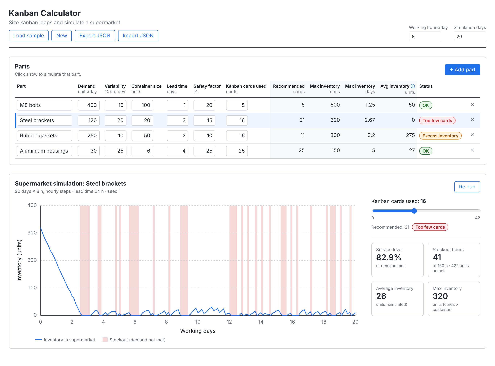
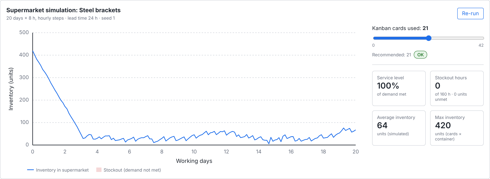

# Kanban Calculator

A web app for sizing kanban loops and simulating a supermarket. Enter your parts, and it recommends
how many kanban cards each loop needs. Then it simulates the supermarket hour by hour, so you can see
how the number of cards affects inventory and stockouts.

Built as a companion to my [Value Stream Mapping tool](https://github.com/CharilaosStavrou/vsm-tool).



## Features

- **Editable parts table**: demand, demand variability, container size, replenishment lead time,
  safety factor and kanban cards used. You can add, edit and delete parts inline. Inputs are
  validated (no negative numbers, demand and container size at least 1, percentages between 0 and 100).
- **Kanban calculations**: recommended number of cards, maximum inventory (units and days of demand),
  average expected inventory and a status for each part: *Too few cards*, *Excess inventory* or *OK*.
  Status uses text labels, not colour alone.
- **Supermarket simulation** for the selected part: an inventory chart with stockout periods shaded
  red, plus service level, stockout hours, average inventory and maximum inventory.
- **Live cards slider**: drag it to see how more or fewer cards change the result.
- **Reproducible randomness**: demand uses a seeded random generator. *Re-run* moves to the next seed.
- **Save and share**: the app saves to localStorage automatically and supports JSON export and import.
  Imported files are validated, and the current data is kept if a file is invalid.



## Formulas

These are the formulas exactly as implemented in [`src/lib/kanbanCalculations.js`](src/lib/kanbanCalculations.js).

```
Recommended cards     = ceil( demand per day × lead time × (1 + safety factor / 100) ÷ container size )
                        at least 1 whenever demand per day > 0

Max inventory (units) = kanban cards used × container size

Max inventory (days)  = max inventory (units) ÷ demand per day

Avg inventory (units) ≈ kanban cards used × container size
                        − demand per day × lead time
                        − container size ÷ 2
                        never below 0

Status                = "Too few cards"     if cards used < recommended
                        "Excess inventory"  if cards used > recommended + 2
                        "OK"                otherwise
```

Units: demand in units/day, lead time in days, container size in units/container, and safety factor
and variability in %.

Before rounding up, the recommended cards calculation subtracts a tolerance of 10⁻⁹. Without it,
floating-point results such as 1.0000000000000002 would add a whole extra card.

The recommended cards formula is the standard Toyota kanban formula. The average inventory
approximation follows from Little's Law. In steady state, the full lead-time demand
(demand × lead time) is in the replenishment pipeline. The container being consumed is on average half full.

### Simulation

[`src/lib/kanbanSimulation.js`](src/lib/kanbanSimulation.js) runs `simulationDays × workingHoursPerDay`
hourly steps:

1. At the start, every kanban card is attached to a full container in the supermarket.
2. Each hour, full containers whose lead time has elapsed arrive in the supermarket first.
3. Then customer demand for that hour is drawn:
   `max(0, normal(mean = demand per day ÷ working hours per day, sd = mean × variability / 100))`.
4. Demand is taken from the supermarket. When a container is emptied, its card goes back to production
   and the full container returns after the lead time. The lead time is converted to working hours and
   rounded to the nearest hour.
5. Demand that cannot be met is recorded as unmet units, and that hour counts as a stockout hour.

Results: service level = (1 − unmet units ÷ total demand) × 100%. Average inventory is the mean of the
end-of-hour inventory levels.

## Assumptions

- **Hourly time step.** Demand, arrivals and inventory are evaluated once per working hour. Lead times
  are rounded to whole working hours, and the clock only runs during working hours.
- **Normally distributed demand.** Hourly demand is normally distributed. The variability (% standard
  deviation) applies to each hour's demand, and negative samples are set to 0. Random numbers come from
  a seeded generator (Mulberry32 with the Box-Muller transform), so results are reproducible.
- **Continuous units.** Demand is not rounded to whole units (e.g. 3.75 units/hour), which keeps the
  results exact.
- **Average inventory approximation.** The table's average inventory is a steady-state approximation.
  It is only meaningful when the loop has enough cards to reach steady state (see
  [Validation](#validation)). The simulated average also includes the start-up period, when the
  supermarket starts full.
- **A 0% safety factor leaves no margin.** With zero variability and the recommended cards, all four
  sample parts reach 100% service level. With a 0% safety factor, however, short stockouts can still
  happen. Example: Rubber gaskets with a 0% safety factor get 10 cards × 50 units = 500 units, which is
  exactly the 2-day lead-time demand. The first container is emptied after 1.6 hours and returns 16 hours
  later, but the stock runs out after 16 hours, so service drops to about 93%. The formula covers the
  lead-time demand but not the container currently being consumed. The safety factor provides that
  margin.

## Validation

The average inventory formula was compared with the simulation at zero variability. "Steady state" is
a 200-day run with the first two lead times dropped as warm-up. The test
*average inventory formula vs simulation* in
[`src/lib/kanbanSimulation.test.js`](src/lib/kanbanSimulation.test.js) checks this comparison.

| Part | Cards | Formula (units) | Simulation, 20 days (units) | Simulation, steady state (units) | Difference |
|---|---:|---:|---:|---:|---:|
| M8 bolts | 5 | 50 | 85.0 | 75.0 | +25.0 |
| Steel brackets | 16 (too few) | 0 | 25.7 | 6.2 | n/a (86% service) |
| Steel brackets | 21 (recommended) | 50 | 79.5 | 52.5 | +2.5 |
| Rubber gaskets | 16 | 275 | 303.8 | 278.1 | +3.1 |
| Aluminium housings | 25 | 27 | 39.5 | 27.4 | +0.4 |

- **Steady state agrees.** For every loop with enough cards, the formula and the steady-state simulation
  agree within half an hour of demand.
- **The M8 bolts gap is a discretization effect of the hourly time step.** One container holds 100
  units, exactly 2 hours of demand (50 units/hour). So every container is emptied exactly at the end of
  an hour, and every emptying and every arrival falls on an hour boundary. Combined with sampling
  inventory only at the end of each hour, this shifts the simulated average up by exactly half an hour
  of demand (25 units) compared with a continuous-time model. Parts whose containers empty part-way
  through an hour (brackets, gaskets, housings) average this effect out, and their gap is much smaller.
  A finer time step would shrink the gap.
- **The 20-day averages are higher** because the supermarket starts full. The first lead time is spent
  drawing down that initial stock.
- **The formula only applies when the loop has enough cards to reach steady state.** With too few cards
  (Steel brackets at 16 cards) the loop keeps stocking out. The formula then gives 0, while the
  simulation shows a small, fluctuating inventory between stockouts.

## Run locally

Requires Node.js 18 or newer.

```bash
git clone https://github.com/CharilaosStavrou/kanban-calculator.git
cd kanban-calculator
npm install
npm run dev      # start the dev server at http://localhost:5173
npm test         # run the unit tests (Vitest)
npm run lint     # run ESLint
npm run build    # production build into dist/
```

## Deploy

The repository includes a [`vercel.json`](vercel.json) for Vite.

1. Push the repository to GitHub.
2. In Vercel, choose **Add New → Project** and import the repository.
3. Keep the detected settings (framework *Vite*, build command `npm run build`, output directory
   `dist`) and click **Deploy**.

The app is fully static, so any static host that serves the `dist/` folder will also work.

## Tech stack

- React 18 + Vite, JavaScript
- Plain CSS with CSS variables, no UI library
- Charts in plain SVG, no chart library
- No backend: state in React, localStorage and JSON files
- Vitest for unit tests, ESLint for linting
- Deployed on Vercel

All calculation and simulation logic lives in `src/lib` as pure functions, separate from the UI in
`src/components`.

## Related project

- [VSM tool](https://github.com/CharilaosStavrou/vsm-tool): a Value Stream Mapping tool. The
  kanban calculator sizes the supermarket loops you would draw on a future-state value stream map.

## Future improvements

- **Multi-stage loops**: chain supermarkets, so that a production kanban at one stage creates
  withdrawal demand at the stage before it.
- **Signal kanban**: model batch production with a reorder point and a lot size, for processes with
  long changeovers.
- **CONWIP comparison**: simulate the same demand with a CONWIP system and compare inventory and
  service level with kanban.

## License

[MIT](LICENSE) © 2026 Charilaos Stavrou
